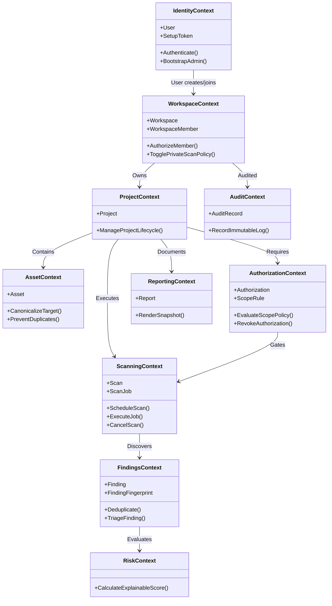
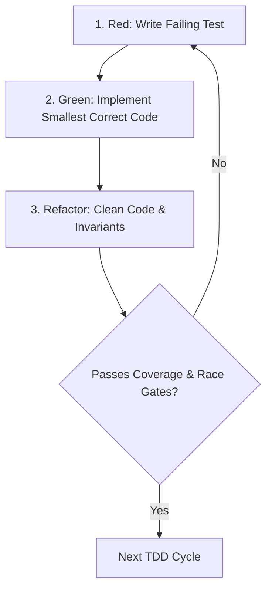

# VULNEX — Architecture Validation & Technical Specification

**Document Version:** 1.0.0  
**Status:** Architecture Baseline Approved — Ready for Phase 0 Implementation  
**Standard:** Domain-Driven Design (DDD), Clean Architecture, SOLID, TDD, Ports & Adapters  

---

## 1. Modular Monolith Architecture Validation

### 1.1 Rationale & Structural Justification
VULNEX adopts a **Modular Monolith** architecture pattern ([`ADR-001`](file:///Users/egichandrapratama/Downloads/vulnex/docs/adr/ADR-001-modular-monolith.md)) for the core application, supplemented by isolated container runtimes for security scanner execution ([`ADR-007`](file:///Users/egichandrapratama/Downloads/vulnex/docs/adr/ADR-007-worker-isolation.md)).

```
┌─────────────────────────────────────────────────────────────────────────────┐
│                           VULNEX Unified Monorepo                           │
│                                                                             │
│  ┌───────────────────────┐ ┌──────────────────────────────────────────────┐ │
│  │   installer/ (CLI)    │ │              backend/ (Go API & Worker)       │ │
│  │   - Standalone binary │ │  ┌──────────────┐      ┌────────────────────┐ │ │
│  │   - Independent module│ │  │   cmd/api    │      │     cmd/worker     │ │ │
│  │   - Control Plane     │ │  └──────┬───────┘      └─────────┬──────────┘ │ │
│  └───────────────────────┘ │         │                        │            │ │
│                            │  ┌──────┴────────────────────────┴──────────┐ │ │
│  ┌───────────────────────┐ │  │             internal/ (Core)             │ │ │
│  │    frontend/ (Web)    │ │  │  identity | workspace | project | asset  │ │ │
│  │    - Next.js + TS     │ │  │  auth     | scanning  | catalog | finding│ │ │
│  │    - Typed API client │ │  │  risk     | report    | audit                │ │ │
│  └───────────────────────┘ │  └──────────────────────────────────────────┘ │ │
│                            └──────────────────────────────────────────────┘ │
│  ┌────────────────────────────────────────────────────────────────────────┐ │
│  │  deploy/ (Docker Compose, Caddy Ingress, Security Configs)             │ │
│  └────────────────────────────────────────────────────────────────────────┘ │
└─────────────────────────────────────────────────────────────────────────────┘
```

#### Why Modular Monolith Over Microservices:
1. **Transactional Atomicity for Critical Invariants:**
   - Scan scheduling requires atomic persistence of the `Scan` record, the `ScanJob` queue entry, and the `outbox_events` record in a single local database transaction. Distributed sagas or 2-phase commit across microservices would introduce excessive failure modes and operational fragility.
2. **Elimination of Premature Network Latency & Marshaling:**
   - Communication between bounded contexts (e.g., verifying asset canonicalization during scan creation) occurs in-process with nanosecond latency, avoiding HTTP/gRPC overhead and network partition failures.
3. **Operational Simplicity for Self-Hosted Deployments:**
   - VULNEX targets self-hosted single-node server and local workstation deployments ([`ADR-009`](file:///Users/egichandrapratama/Downloads/vulnex/docs/adr/ADR-009-self-hosted-first-saas-ready.md)). Running a distributed mesh of microservices would drastically increase RAM/CPU minimums, making local evaluation prohibitive.
4. **Independent Worker Scalability Retained:**
   - The modular monolith codebase compiles into two distinct binaries from the same module: `cmd/api` (HTTP REST API) and `cmd/worker` (asynchronous scanner supervisor). In server deployments, `worker` instances can be scaled horizontally without modifying the application code or data schema.

### 1.2 Boundary Enforcement Mechanism
To prevent modular monoliths from degrading into a "big ball of mud", boundary isolation is enforced via three non-negotiable mechanisms:
1. **Go Package Privacy (`internal/`):**
   - Context implementations reside in `backend/internal/<context>/`.
   - Go's compiler enforces that code outside `backend/internal/` cannot import internal packages.
2. **Explicit Layer Hierarchy Within Each Context:**
   - `domain/` contains zero external imports (no database, no HTTP, no third-party libraries).
   - `application/` imports only `domain/`.
   - `infrastructure/` and `delivery/` import `application/` and `domain/`.
   - Direction of dependency: `Delivery → Application → Domain ← Infrastructure`.
3. **Automated Architecture Tests (CI Gate):**
   - Architecture tests validate AST import graphs using Go static analysis. Any PR introducing a circular context dependency, cross-context direct database model import, or an outer-layer import into `domain/` immediately fails CI.

---

## 2. Bounded Contexts & Module Responsibilities



### Context Breakdown:

| Bounded Context | Core Responsibility | Non-Responsibilities |
|---|---|---|
| **`identity`** | User registration, authentication, session tokens, slow password hashing (Argon2id), initial admin setup token validation ([`ADR-013`](file:///Users/egichandrapratama/Downloads/vulnex/docs/adr/ADR-013-admin-bootstrap-token.md)). | Authorization to specific workspace resources (owned by `workspace`). |
| **`workspace`** | Workspace aggregate, membership lifecycle, roles (`Owner`, `Admin`, `Member`, `Viewer`), workspace-level security policies (`allow_private_network_scan`, [`ADR-015`](file:///Users/egichandrapratama/Downloads/vulnex/docs/adr/ADR-015-workspace-private-network-policy.md)). | Project-specific configuration, scan execution. |
| **`project`** | Grouping security assessments, tracking assessment lifecycle (`ACTIVE`, `ARCHIVED`), scoping project metadata. | Asset normalization, scan execution. |
| **`asset`** | Managing target inventory (domain, hostname, IPv4, IPv6, URL), strict canonicalization, duplicate prevention per project. | Network reachability validation, scan execution. |
| **`authorization`** | Managing written testing agreements, evidence file checksums, timeframes, approvers, permitted testing methods, include/exclude scope rules, `ScopePolicy` evaluation. | Network packet transmission, scanner execution. |
| **`scanning`** | Scan lifecycle state machine (`QUEUED`, `RUNNING`, `COMPLETED`, `FAILED`, `CANCELLED`, `TIMED_OUT`), job lease queue, timeout enforcement, emergency cancellation. | Scanner-specific CLI flags, output normalization. |
| **`scanner_catalog`** | Approved scanner profiles (Nmap, ZAP, later Nuclei), immutable versions, typed configuration mapping. | Running scanner containers. |
| **`findings`** | Untrusted scanner result ingestion, deterministic fingerprint generation, deduplication, finding status triage (`OPEN`, `RESOLVED`, etc.). | Calculating overall project risk scores. |
| **`risk`** | Pure domain calculation of explainable risk scores using versioned mathematical models. | Storing findings, executing scans. |
| **`reporting`** | Generating immutable point-in-time assessment reports (HTML, JSON), report export authorization. | Finding triage or modification. |
| **`audit`** | Append-only logging of security-critical actions with actor, resource, and correlation IDs. | Business rule enforcement. |

---

## 3. Rich Domain Model Specification

### 3.1 Aggregates, Entities, and Invariants

#### 1. `Workspace` Aggregate Root (`workspace/domain`)
- **Root Entity:** `Workspace`
- **Internal Entities:** `WorkspaceMember`
- **Value Objects:** `WorkspaceID`, `UserID`, `WorkspaceRole`, `WorkspaceStatus`, `PolicySettings`
- **Invariants:**
  - Must have at least one `Owner` at all times. Demoting or removing the sole owner returns `ErrCannotRemoveSoleOwner`.
  - Membership is unique per `(WorkspaceID, UserID)`.
  - `AllowPrivateNetworkScan` can only be set to `true` by an `Owner` or `Admin` and requires an associated written authorization ID.

#### 2. `Asset` Aggregate Root (`asset/domain`)
- **Root Entity:** `Asset`
- **Value Objects:** `AssetID`, `ProjectID`, `AssetType` (`DOMAIN`, `HOSTNAME`, `IPV4`, `IPV6`, `URL`), `CanonicalAssetValue`, `AssetCriticality` (`LOW`, `MEDIUM`, `HIGH`, `CRITICAL`), `AssetStatus`
- **Invariants:**
  - `CanonicalAssetValue` validates syntax on creation (e.g. hostnames converted to lowercase, URLs stripped of unnecessary fragments/trailing slashes, IP addresses canonicalized without leading zeros).
  - Uniqueness invariant: A project cannot contain duplicate canonical assets of the same type.

#### 3. `Authorization` Aggregate Root (`authorization/domain`)
- **Root Entity:** `Authorization`
- **Internal Entities:** `AuthorizationScopeRule`
- **Value Objects:** `AuthorizationID`, `ProjectID`, `AuthorizationStatus` (`DRAFT`, `ACTIVE`, `EXPIRED`, `REVOKED`), `ValidityPeriod`, `EvidenceChecksum`, `ScopeRuleType` (`INCLUDE`, `EXCLUDE`), `PermittedMethod`
- **Invariants:**
  - `ValidityPeriod` enforces `ValidUntil > ValidFrom`.
  - Once status transitions to `REVOKED`, it is terminal. Revocation cannot be undone; a new authorization must be created.
  - In `ScopePolicy`, `EXCLUDE` rules take unconditional precedence over `INCLUDE` rules.

#### 4. `Scan` Aggregate Root (`scanning/domain`)
- **Root Entity:** `Scan`
- **Internal Entities:** `ScanTarget`, `ScanJob`
- **Value Objects:** `ScanID`, `WorkspaceID`, `ProjectID`, `AuthorizationID`, `ScannerProfileVersionID`, `ScanStatus`, `IdempotencyKey`, `ResourceLimit`
- **Invariants:**
  - State machine is strictly forward-progressing:
    `QUEUED` → `RUNNING` → (`COMPLETED` | `FAILED` | `CANCELLED` | `TIMED_OUT`).
  - Terminal states (`COMPLETED`, `FAILED`, `CANCELLED`, `TIMED_OUT`) are immutable. Any attempt to transition out of a terminal state returns `ErrScanAlreadyTerminal`.
  - Cancellation is only accepted if current status is `QUEUED` or `RUNNING`.
  - Scan creation requires non-empty target list and verified active authorization reference.

#### 5. `Finding` Aggregate Root (`findings/domain`)
- **Root Entity:** `Finding`
- **Internal Entities:** `FindingEvidence`
- **Value Objects:** `FindingID`, `FindingFingerprint`, `Severity` (`INFO`, `LOW`, `MEDIUM`, `HIGH`, `CRITICAL`), `Confidence` (`LOW`, `MEDIUM`, `HIGH`, `CONFIRMED`), `FindingStatus`, `RiskScore`
- **Invariants:**
  - `FindingFingerprint` is a deterministic SHA-256 hash:
    `SHA256(ProjectID + CanonicalAssetValue + ScannerType + VulnerabilityKey + LocationKey)`.
  - When a finding with an existing fingerprint is re-observed, `last_seen_at` is updated and `occurrence_count` incremented; a new finding entity is NOT created.
  - Transitions to `ACCEPTED_RISK` or `FALSE_POSITIVE` require a non-empty audit rationale.

#### 6. `SetupToken` Aggregate Root (`identity/domain`)
- **Root Entity:** `SetupToken`
- **Value Objects:** `TokenID`, `TokenHash`, `ExpiryTimestamp`, `UsedTimestamp`
- **Invariants:**
  - Token is single-use. `Claim(providedToken)` verifies hash, asserts `UsedTimestamp.IsZero()` and `Now() < ExpiryTimestamp`.
  - Once claimed, `UsedTimestamp` is set, invalidating further claims.

### 3.2 Pure Domain Services

```go
package domain

// ScopePolicy evaluates target membership against authorization rules.
// Contains zero I/O, zero network, zero database calls.
type ScopePolicy struct{}

func (p ScopePolicy) IsAuthorized(target CanonicalTarget, rules []ScopeRule) bool {
    included := false
    for _, rule := range rules {
        if rule.Matches(target) {
            if rule.Type == RuleTypeExclude {
                return false // Exclusion immediately overrides
            }
            if rule.Type == RuleTypeInclude {
                included = true
            }
        }
    }
    return included
}
```

```go
package domain

import "net"

// NetworkDestinationPolicy validates resolved IP addresses immediately prior to connection.
type NetworkDestinationPolicy struct{}

func (p NetworkDestinationPolicy) ValidateDestination(ip net.IP, allowPrivate bool) error {
    if ip.IsLoopback() {
        return ErrLoopbackProhibited
    }
    if ip.IsLinkLocalUnicast() || ip.IsLinkLocalMulticast() {
        return ErrLinkLocalProhibited
    }
    if ip.Equal(net.ParseIP("169.254.169.254")) {
        return ErrCloudMetadataProhibited
    }
    if isDockerInternalSubnet(ip) {
        return ErrInternalNetworkProhibited
    }
    if isPrivateNetwork(ip) && !allowPrivate {
        return ErrPrivateNetworkDeniedByDefault
    }
    return nil
}
```

```go
package domain

// RiskScoringService computes an explainable, deterministic risk score.
type RiskScoringService struct{}

func (s RiskScoringService) Calculate(sev Severity, conf Confidence, crit AssetCriticality) RiskScore {
    base := sev.BaseWeight() * conf.Multiplier()
    finalScore := base * crit.Multiplier()
    return NewRiskScore(finalScore, "v1.0.0")
}
```

---

## 4. Application Use Cases

Application use cases orchestrate the domain model, enforce authorization, call repository ports, and publish domain events.

```
┌────────────────────────────────────────────────────────────────────────┐
│                        Application Use Case Flow                       │
│                                                                        │
│  HTTP / Worker Request                                                 │
│       │                                                                │
│       ▼                                                                │
│  [1. Input Validation & DTO Mapping]                                  │
│       │                                                                │
│       ▼                                                                │
│  [2. Authorization & Tenant Check (Workspace Context)]                │
│       │                                                                │
│       ▼                                                                │
│  [3. Load Aggregate via Repository Port]                              │
│       │                                                                │
│       ▼                                                                │
│  [4. Invoke Aggregate Invariant / Domain Service]                      │
│       │                                                                │
│       ▼                                                                │
│  [5. Persist Aggregate & Enqueue Outbox Event in Atomic Tx]           │
│       │                                                                │
│       ▼                                                                │
│  [6. Return Result DTO / Emit Domain Event]                            │
└────────────────────────────────────────────────────────────────────────┘
```

### Key Use Cases Specification:

1. **`SetupInitialAdminUseCase` (`identity/application`):**
   - **Command:** `SetupInitialAdminCommand{Token, Email, Password, DisplayName}`
   - **Flow:**
     1. Verifies system has 0 active administrators.
     2. Validates and claims `SetupToken` via `SetupTokenRepository`.
     3. Hashes password using `PasswordHasherPort` (Argon2id).
     4. Creates initial `User` (Role: SuperAdmin) and default `Workspace`.
     5. Emits `AdminBootstrappedEvent`.
2. **`RequestScanUseCase` (`scanning/application`):**
   - **Command:** `RequestScanCommand{WorkspaceID, ProjectID, AuthorizationID, ProfileVersionID, AssetIDs, IdempotencyKey}`
   - **Flow:**
     1. Asserts caller has `ProjectOperator` permission.
     2. Loads `Authorization`; verifies validity period and unrevoked status.
     3. Loads `Assets`; runs `ScopePolicy.IsAuthorized(asset, auth.Rules)`. Fails if any asset is out of scope.
     4. Loads `ScannerProfileVersion`; confirms approved status.
     5. Constructs `Scan` aggregate in `QUEUED` state and corresponding `ScanJob`.
     6. Persists `Scan`, `ScanJob`, and `ScanQueuedEvent` in a single PostgreSQL transaction.
3. **`ProcessScanJobUseCase` (`scanning/application` - Worker Process):**
   - **Command:** `ProcessScanJobCommand{JobID, WorkerID}`
   - **Flow:**
     1. Verifies lease ownership and extends heartbeat.
     2. Re-validates authorization status and scope immediately before execution.
     3. Resolves target hostnames via `DNSResolverPort`.
     4. Passes resolved IPs to `NetworkDestinationPolicy.ValidateDestination(ip, workspace.AllowPrivateNetworkScan)`.
     5. Dispatches execution to `ScannerAdapterPort` with strict timeout and resource limits.
     6. Streams raw scanner output to `ScannerOutputParserPort`.
     7. Dispatches parsed observations to `IngestFindingsUseCase`.
     8. Updates `Scan` status to `COMPLETED` (or `FAILED`).
4. **`CancelScanUseCase` (`scanning/application`):**
   - **Command:** `CancelScanCommand{ScanID, WorkspaceID, Reason}`
   - **Flow:**
     1. Transitions `Scan` aggregate to `CANCELLED`.
     2. Sends cooperative cancellation signal to executing worker context.
     3. If worker does not terminate within grace period (15s), worker supervisor terminates container forcefully.
     4. Emits `ScanCancelledEvent`.
5. **`IngestFindingsUseCase` (`findings/application`):**
   - **Command:** `IngestFindingsCommand{ScanID, Observations}`
   - **Flow:**
     1. For each observation, computes deterministic `FindingFingerprint`.
     2. Queries `FindingRepository.FindByFingerprint(projectID, fingerprint)`.
     3. If exists: updates `last_seen_at` and increments occurrences.
     4. If new: calculates risk score via `RiskScoringService`, initializes `Finding` aggregate in `OPEN` state.
     5. Persists findings and stores raw evidence via `SecureStoragePort`.

---

## 5. Ports and Adapters (Hexagonal Architecture)

All interfaces are owned by the Domain or Application layer. The Infrastructure and Delivery layers provide concrete implementations.

```
                     ┌──────────────────────────────────┐
                     │          DELIVERY LAYER          │
                     │  HTTP Handlers (Chi)             │
                     │  CLI Commands (Cobra)            │
                     │  Worker Poll Loop                │
                     └────────────────┬─────────────────┘
                                      │ Invokes (Driving)
                                      ▼
                     ┌──────────────────────────────────┐
                     │        APPLICATION LAYER         │
                     │  Use Cases, Commands, Queries    │
                     └────────────────┬─────────────────┘
                                      │ Invokes
                                      ▼
┌─────────────────────────────────────┴─────────────────────────────────────┐
│                               DOMAIN LAYER                                │
│        Aggregates, Entities, Value Objects, Domain Policies               │
│                                                                           │
│   PRIMARY PORTS (Inbound)            SECONDARY PORTS (Outbound)           │
│   - SetupAdminUseCase                - UserRepository                     │
│   - RequestScanUseCase               - ScanRepository                     │
│   - CancelScanUseCase                - FindingRepository                  │
│   - IngestFindingsUseCase            - JobQueuePort                       │
│                                      - ScannerAdapterPort                 │
│                                      - SecureStoragePort                  │
│                                      - DNSResolverPort                    │
│                                      - PasswordHasherPort                 │
└─────────────────────────────────────┬─────────────────────────────────────┘
                                      ▲
                                      │ Implements (Driven)
                     ┌────────────────┴─────────────────┐
                     │       INFRASTRUCTURE LAYER       │
                     │  Postgres Repositories (pgx)     │
                     │  Docker Runner (Container Engine)│
                     │  Local Volume Secure Storage     │
                     │  Caddy Ingress Reverse Proxy     │
                     │  Argon2id Hasher                 │
                     └──────────────────────────────────┘
```

### 5.1 Outbound Port Definitions (Code Signatures)

```go
package ports

import (
    "context"
    "io"
    "net"
    "time"
    "vulnex/backend/internal/scanning/domain"
)

// ScanRepository defines persistence operations for the Scan aggregate.
type ScanRepository interface {
    Save(ctx context.Context, scan *domain.Scan) error
    GetByID(ctx context.Context, id domain.ScanID) (*domain.Scan, error)
    Update(ctx context.Context, scan *domain.Scan) error
}

// JobQueuePort defines operations for worker lease claims using PostgreSQL SKIP LOCKED.
type JobQueuePort interface {
    ClaimNextJob(ctx context.Context, workerID string, leaseDuration time.Duration) (*domain.ScanJob, error)
    RenewHeartbeat(ctx context.Context, jobID domain.JobID, workerID string, extension time.Duration) error
    CompleteJob(ctx context.Context, jobID domain.JobID) error
    FailJob(ctx context.Context, jobID domain.JobID, errCode string, retryable bool) error
}

// ScannerAdapterPort defines the contract for external scanner invocation.
type ScannerAdapterPort interface {
    Name() string
    ValidateProfile(ctx context.Context, profile domain.ScannerProfile) error
    ExecuteScan(ctx context.Context, req domain.ScanExecutionRequest) (domain.RawArtifact, error)
}

// SecureStoragePort abstracts storage of raw scanner outputs and exported reports.
type SecureStoragePort interface {
    SaveArtifact(ctx context.Context, reference string, reader io.Reader) (checksum string, err error)
    RetrieveArtifact(ctx context.Context, reference string) (io.ReadCloser, error)
    DeleteArtifact(ctx context.Context, reference string) error
}

// DNSResolverPort abstracts execution-time DNS resolution for SSRF verification.
type DNSResolverPort interface {
    LookupIPAddr(ctx context.Context, host string) ([]net.IP, error)
}
```

---

## 6. Module Dependencies & Integration Boundaries

### 6.1 Monorepo Module Structure
The monorepo contains four primary subsystems with strictly governed Go module definitions:
1. `backend/`: Go module `github.com/vulnex/vulnex/backend`
2. `installer/`: Go module `github.com/vulnex/vulnex/installer` (Zero dependencies on backend)
3. `frontend/`: Node.js / Next.js application
4. `deploy/`: Declarative Compose files and Caddyfile templates

### 6.2 Cross-Context Communication Matrix

```
Caller Context ──► Target Context ──► Allowed Communication Channel
──────────────────────────────────────────────────────────────────
API Delivery    ──► Any Context    ──► Invokes Application Use Case
Scanning        ──► Authorization  ──► Queries AuthorizationPort (Interface)
Scanning        ──► Asset          ──► Reads TargetSnapshot (Value Object)
Scanning Worker ──► Findings       ──► Invokes IngestFindingsUseCase
Any Context     ──► Audit          ──► Publishes Domain Event via Outbox
Any Context     ──► Outbox         ──► Atomic SQL commit in owning Tx
```

**Architectural Prohibitions:**
- **No Direct Table Joins Across Contexts:** Context A's repository never joins Context B's database table.
- **No Direct Mutation Across Contexts:** Context A never calls `Update` on Context B's aggregate directly; it dispatches a command through Context B's application use case.
- **No Domain Model Leakage:** DTOs are mapped at application/delivery boundaries; domain entities are never serialized directly to HTTP responses.

---

## 7. Database Ownership & Persistence Boundaries

Every table in PostgreSQL is owned by exactly one bounded context. Cross-table foreign keys represent aggregate identity references.

```
┌────────────────────────────────────────────────────────────────────────┐
│                      PostgreSQL Database Schemas                       │
│                                                                        │
│  [Identity Context]           [Project Context]                        │
│  - users                      - projects                               │
│  - setup_tokens (ADR-013)                                              │
│                               [Asset Context]                          │
│  [Workspace Context]          - assets                                 │
│  - workspaces (ADR-015)                                                │
│  - workspace_members          [Authorization Context]                  │
│                               - authorizations                         │
│  [Catalog Context]            - authorization_scopes                   │
│  - scanner_profiles                                                    │
│  - scanner_profile_versions   [Findings Context]                       │
│                               - findings                               │
│  [Scanning Context]           - finding_evidence                       │
│  - scans                      - remediations (P1)                      │
│  - scan_targets                                                        │
│  - scan_jobs (Lease queue)    [Reporting Context]   [Audit Context]    │
│  - outbox_events              - reports             - audit_logs       │
└────────────────────────────────────────────────────────────────────────┘
```

### PostgreSQL Transactional Job Queue Implementation
The job queue uses PostgreSQL row-level locks without external broker overhead ([`ADR-003`](file:///Users/egichandrapratama/Downloads/vulnex/docs/adr/ADR-003-postgresql-queue.md)):

```sql
-- Atomic, non-blocking worker lease claim
UPDATE scan_jobs
SET status = 'RUNNING',
    lease_owner = $1,
    lease_expires_at = clock_timestamp() + ($2 || ' seconds')::INTERVAL,
    attempt = attempt + 1,
    updated_at = clock_timestamp()
WHERE id = (
    SELECT id
    FROM scan_jobs
    WHERE status = 'QUEUED'
      AND available_at <= clock_timestamp()
      AND (lease_expires_at IS NULL OR lease_expires_at < clock_timestamp())
    ORDER BY created_at ASC
    FOR UPDATE SKIP LOCKED
    LIMIT 1
)
RETURNING id, scan_id, attempt;
```

---

## 8. External Scanner Integration Boundaries

### 8.1 Scanner Execution Security Architecture
External tools (Nmap, OWASP ZAP) run inside restricted Docker containers managed by the worker daemon ([`ADR-007`](file:///Users/egichandrapratama/Downloads/vulnex/docs/adr/ADR-007-worker-isolation.md)).

```
┌────────────────────────────────────────────────────────────────────────┐
│                     Scanner Container Sandbox Policy                   │
│                                                                        │
│  1. Unprivileged Execution: Non-root user (UID 10001)                  │
│  2. Dropped Capabilities: cap_drop: ALL (Nmap retains CAP_NET_RAW only)│
│  3. Read-Only Root Filesystem: read_only: true                         │
│  4. Isolated Egress Network: Dedicated bridge, no internal Docker DNS   │
│  5. Hard Resource Ceilings: CPU 1.0, RAM 512MB, PIDs 100               │
│  6. Bounded Output Buffer: Max 50MB stream cap                         │
│  7. Wall-Clock Timeout: Force kill via SIGKILL after 30s grace period  │
│  8. ZERO Docker Socket Mount: Host /var/run/docker.sock NOT visible    │
└────────────────────────────────────────────────────────────────────────┘
```

### 8.2 Anti-Corruption Layer (ACL) & Stream Parsing
1. **Request Translation:**
   - The adapter translates `domain.ScanExecutionRequest` into typed command arguments.
   - String concatenation of shell commands is strictly prohibited (`exec.CommandContext` with explicit argument slice).
2. **Untrusted Stream Parsing:**
   - Scanner stdout/stderr is piped directly into a bounded parser implementing `io.LimitReader(stream, 50*1024*1024)`.
   - The parser constructs `RawObservation` structs, validating schema tags and escaping arbitrary HTML.
   - If the scanner exits with a non-zero code or the stream is truncated, the job is marked `FAILED` and partial results are discarded.

---

## 9. Testing Strategy (TDD)

Development strictly follows the Red-Green-Refactor cycle ([`docs/development/TESTING.md`](file:///Users/egichandrapratama/Downloads/vulnex/docs/development/TESTING.md#L88-L106)).



### 9.1 Test Layers & Coverage Targets

| Test Layer | Focus Area | Isolation Strategy | Target Coverage |
|---|---|---|---|
| **Domain Unit Tests** | Aggregates, value objects, domain services, state machines. | 100% in-memory; zero DB, zero network, zero files. Table-driven tests. | **95%+** |
| **Application Tests** | Use cases, command handlers, workflow coordination. | In-memory repository fakes, mocked external ports. | **90%+** |
| **Adapter Integration** | PostgreSQL repositories, migrations, outbox, lease queue. | Disposable PostgreSQL via `testcontainers-go`. | **85%+** |
| **Scanner Conformance** | Adapter translation, output stream parsers, sandbox enforcement. | Mock scanner stdout fixtures; malformed and oversized payloads. | **90%+** |
| **Security & Safety** | SSRF bypass vectors, DNS rebinding, tenancy isolation, token reuse. | Dedicated test suites with mock DNS servers and malicious IPs. | **100% of defined vectors** |
| **End-to-End (E2E)** | Full deployment, web onboarding, CLI installation, lifecycle. | Clean Docker environment running Compose stack. | Critical paths |

### 9.2 Mandatory Security Test Cases
1. **SSRF & DNS Rebinding Matrix:**
   - Hostnames resolving to `127.0.0.1`, `::1`, `10.0.0.0/8`, `172.16.0.0/12`, `192.168.0.0/16`, `169.254.169.254`, and IPv4-mapped IPv6 (`::ffff:127.0.0.1`).
   - Mixed DNS answers (one public IP, one private IP) must fail closed.
   - Time-of-check to time-of-use (TOCTOU) DNS rebinding scenarios where DNS changes between scan request and worker connection.
2. **Setup Token Security Matrix:**
   - Expired token rejected.
   - Reused token rejected.
   - Guessing attacks rate-limited.
   - Token creation disabled after first admin created.
3. **Tenant Boundary Matrix:**
   - User in Workspace A attempting to read/update projects, assets, scans, or findings in Workspace B returns `404 Not Found` (never `403 Forbidden` to prevent resource enumeration).

---

## 10. Security Controls Across Modules

| Module / Layer | Primary Threat | Enforced Technical Security Control |
|---|---|---|
| **Delivery (Caddy)** | MitM, Insecure transport, Header spoofing | Automated ACME TLS ([`ADR-014`](file:///Users/egichandrapratama/Downloads/vulnex/docs/adr/ADR-014-caddy-server-ingress.md)), HTTP to HTTPS redirect, trusted proxy CIDR filtering for `X-Forwarded-*`. |
| **Identity** | Credential brute-forcing, Token interception | Argon2id slow hashing, secure HTTP-only SameSite cookies, single-use hashed setup token ([`ADR-013`](file:///Users/egichandrapratama/Downloads/vulnex/docs/adr/ADR-013-admin-bootstrap-token.md)). |
| **Workspace** | Cross-tenant access, unauthorized network pivot | Mandatory workspace scoping on every query (`WHERE workspace_id = $1`), explicit admin opt-in for private scanning ([`ADR-015`](file:///Users/egichandrapratama/Downloads/vulnex/docs/adr/ADR-015-workspace-private-network-policy.md)). |
| **Asset** | Malformed input, ReDoS, Target injection | Strict regex canonicalization, scheme validation, target uniqueness constraints. |
| **Authorization** | Unauthorized assessment | Written authorization validation, exclusion precedence over inclusions, fail-closed revocation. |
| **Scanning** | SSRF, Network pivoting, Resource exhaustion | Dual-gate scope validation, connection-time DNS re-resolution, permanent cloud metadata/loopback block, cgroup limits, timeout supervisor. |
| **Adapters** | Command injection, Container breakout | Zero shell interpolation, unprivileged container execution, read-only root filesystems, dropped Linux capabilities, zero Docker socket mount ([`ADR-007`](file:///Users/egichandrapratama/Downloads/vulnex/docs/adr/ADR-007-worker-isolation.md), [`ADR-011`](file:///Users/egichandrapratama/Downloads/vulnex/docs/adr/ADR-011-no-arbitrary-scanner-commands.md)). |
| **Findings** | Malicious scanner output, XSS | Untrusted stream parsing, 50MB stream cap, HTML entity escaping in descriptions, deterministic fingerprinting. |
| **Audit** | Log tampering, Credential leakage | Append-only database logs, database user permissions revoke `UPDATE`/`DELETE`, automated token redaction. |

---

## 11. Architectural Sign-Off

The architecture documented herein satisfies all product requirements, security constraints, and engineering principles.

**Approval Required to Proceed to Phase 0 (Monorepo Scaffolding & CI Pipeline):**
- [ ] Approved to initialize Monorepo structure, Go modules, Makefile, and CI guardrails.
- [ ] Approved to proceed with TDD test implementation according to the sequence above.
