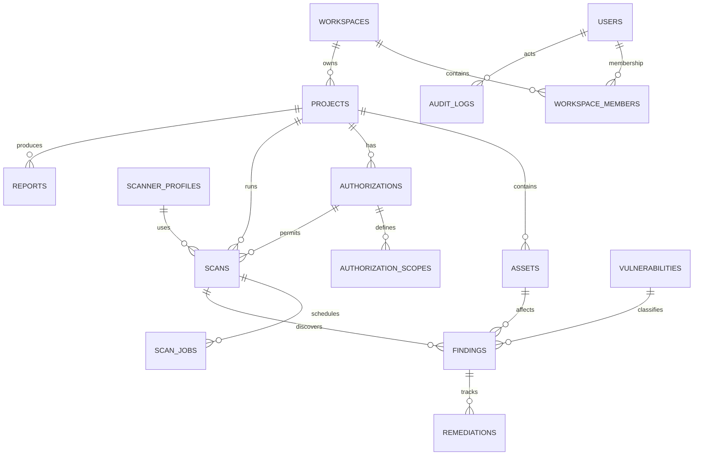

# Database Design

## 1. Conventions
- PostgreSQL.
- UUID primary keys.
- `timestamptz` for instants.
- UTC storage.
- Foreign keys and explicit indexes.
- Versioned migrations.
- Tenant/workspace ownership is explicit.
- JSONB only for bounded, validated semi-structured configuration/metadata.
- Large evidence and scanner artifacts stored outside relational rows with protected references and checksums.

## 2. Logical ERD

## 3. Tables

### users
`id`, `email_normalized`, `password_hash`, `display_name`, `status`, `created_at`, `updated_at`.
Unique index on normalized email.

### setup_tokens
`id`, `token_hash`, `expires_at`, `used_at`, `created_at`.
Unique index on `token_hash`. Ephemeral, single-use bootstrap tokens stored exclusively as cryptographic hashes (ADR-013).

### workspaces
`id`, `name`, `owner_user_id`, `allow_private_network_scan`, `status`, `created_at`, `updated_at`.
`allow_private_network_scan` boolean defaults to `false`; toggleable only by workspace administrator with written authorization (ADR-015).

### workspace_members
`id`, `workspace_id`, `user_id`, `role`, `created_at`.
Unique `(workspace_id, user_id)`.

### projects
`id`, `workspace_id`, `name`, `description`, `status`, `created_by`, `created_at`, `updated_at`.
Index `(workspace_id, status)`.

### assets
`id`, `project_id`, `asset_type`, `canonical_value`, `display_value`, `criticality`, `environment`, `status`, `metadata`, `created_at`, `updated_at`.
Unique `(project_id, asset_type, canonical_value)`.

### authorizations
`id`, `project_id`, `status`, `authorized_party`, `approver_user_id`, `evidence_reference`, `evidence_checksum`, `valid_from`, `valid_until`, `allowed_methods`, `created_at`, `revoked_at`, `revocation_reason`.

### authorization_scopes
`id`, `authorization_id`, `rule_type`, `target_type`, `canonical_target`, `port_range`, `notes`.
Rule type: INCLUDE or EXCLUDE. Exclusions take precedence.

### scanner_profiles
`id`, `name`, `scanner_type`, `description`, `status`, `created_at`.
Profile versions should be immutable.

### scanner_profile_versions
`id`, `scanner_profile_id`, `version`, `configuration`, `approved_by`, `approved_at`, `checksum`, `status`.
Unique `(scanner_profile_id, version)`.

### scans
`id`, `workspace_id`, `project_id`, `authorization_id`, `scanner_profile_version_id`, `requested_by`, `status`, `idempotency_key`, `target_snapshot`, `started_at`, `completed_at`, `created_at`, `updated_at`.
Unique idempotency key in appropriate workspace/project scope.

### scan_targets
`id`, `scan_id`, `asset_id`, `canonical_target`, `target_status`, `resolved_snapshot`, `validation_result`.

### scan_jobs
`id`, `scan_id`, `status`, `attempt`, `lease_owner`, `lease_expires_at`, `available_at`, `last_error_code`, `created_at`, `updated_at`.

### vulnerabilities
`id`, `cve_id`, `cwe_id`, `title`, `description`, `cvss_version`, `cvss_score`, `source`, `source_updated_at`.

### findings
`id`, `workspace_id`, `project_id`, `scan_id`, `asset_id`, `vulnerability_id`, `fingerprint`, `title`, `description`, `severity`, `confidence`, `status`, `source_scanner`, `first_seen_at`, `last_seen_at`, `risk_model_version`, `risk_score`.

### finding_evidence
`id`, `finding_id`, `evidence_type`, `protected_reference`, `checksum`, `redaction_status`, `created_at`.

### remediations
`id`, `finding_id`, `assigned_to`, `description`, `status`, `due_at`, `completed_at`, `created_at`, `updated_at`.

### reports
`id`, `workspace_id`, `project_id`, `requested_by`, `format`, `status`, `file_reference`, `checksum`, `snapshot_version`, `created_at`, `completed_at`.

### audit_logs
`id`, `workspace_id`, `actor_user_id`, `action`, `resource_type`, `resource_id`, `correlation_id`, `metadata_redacted`, `created_at`.
Application role should not expose update/delete operations for audit records.

### outbox_events
`id`, `aggregate_type`, `aggregate_id`, `event_type`, `payload`, `occurred_at`, `published_at`, `attempts`.

## 4. Indexing
- Workspace and project foreign keys.
- Asset canonical value.
- Scan status and creation time.
- Job status and available time.
- Finding project/status/severity.
- Finding fingerprint.
- Audit workspace/time.
- Report project/time.

Validate query plans against representative data before adding speculative indexes.

## 5. Data retention
Define configurable retention for raw scanner artifacts, evidence, reports, and audit logs. Retention must not silently delete records subject to an organization's legal or operational hold. Provide explicit deletion/export workflows for workspace administrators.
