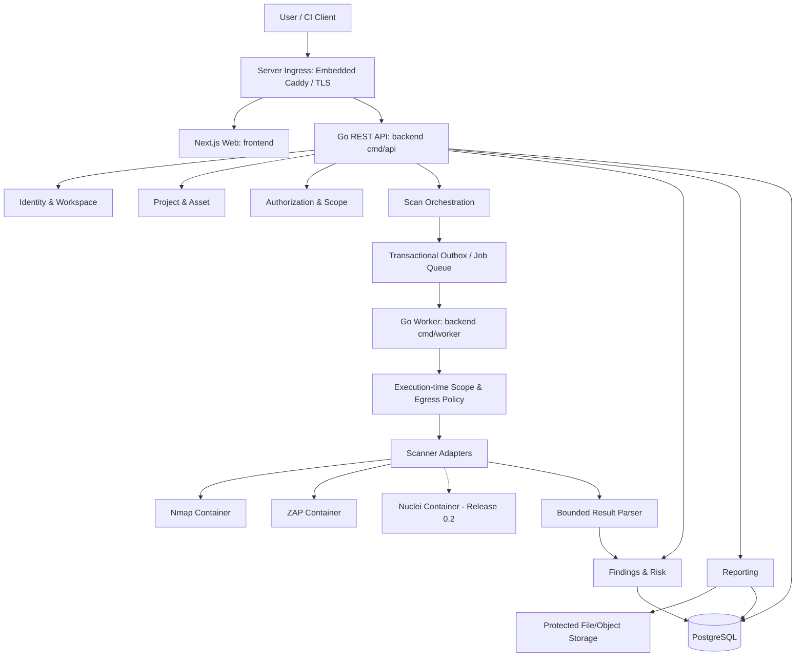

# System Architecture

## 1. Architecture style

Modular monolith for core business capabilities, with API and worker as separately runnable processes from the same codebase. Scanner execution occurs in isolated containers/processes. This avoids premature microservices while allowing worker scaling.

## 2. Logical architecture



## 3. Monorepo structure

```text
vulnex/
  backend/
    cmd/
      api/
      worker/
    internal/
      identity/
        domain/
        application/
        infrastructure/
        delivery/
      workspace/
      project/
      asset/
      authorization/
      scanning/
      scanner_catalog/
      findings/
      vulnerability/
      risk/
      reporting/
      audit/
    pkg/
      config/
      observability/
      securestorage/
    migrations/
    api/openapi/
  frontend/
    app/
    features/
      auth/
      workspaces/
      projects/
      assets/
      authorizations/
      scans/
      findings/
      reports/
    components/
    lib/
      api/
      auth/
      validation/
    types/
  installer/
    cmd/
      vulnex/
    internal/
      environment/
      installation/
      runtime/
      configuration/
      deployment/
      lifecycle/
      maintenance/
      diagnostics/
  deploy/
    compose/
      docker-compose.local.yml
      docker-compose.server.yml
      caddy/
        Caddyfile
  docs/
  tests/
```

Use typed API clients generated from OpenAPI where practical. Frontend checks improve UX but never replace server-side authorization.

## 5. Scanner adapter contract

```go
type Scanner interface {
    Name() string
    ValidateProfile(ctx context.Context, profile Profile) error
    Execute(ctx context.Context, request ScanRequest) (ScanResult, error)
}
```

The request contains a validated target snapshot, authorization reference, profile version, timeout, and resource policy. It does not contain arbitrary shell commands.

Adapters:
- map approved profile fields to fixed tool arguments;
- invoke scanner in isolation;
- capture bounded output and execution metadata;
- parse untrusted output;
- return normalized observations;
- never write directly to database.

## 6. Job processing

- API validates and persists scan plus job in one transaction/outbox flow.
- Worker claims jobs using a concurrency-safe lease/locking strategy.
- Worker rechecks authorization, scope, profile status, and target resolution.
- Worker starts isolated scanner execution with limits.
- Results are parsed and persisted idempotently.
- Job state transition and audit event are committed.
- Expired leases are recovered; duplicate delivery is expected and safe.

MVP may use PostgreSQL-backed jobs/outbox. Introduce Redis or a dedicated broker only after measured queue requirements justify it.

## 7. Deployment topology

### Self-hosted MVP
- `caddy`: Embedded reverse proxy (Server mode) with automatic ACME TLS certificate management (ADR-014).
- `web`: Next.js frontend.
- `api`: Go API.
- `worker`: Go worker.
- `postgres`: database and job queue.
- scanner runtime: isolated containers launched through a controlled execution mechanism.
- optional protected file storage for evidence/reports.

Do not mount the Docker socket into the general API container. If container orchestration is required, use a narrowly scoped worker-side executor or dedicated runtime service with restricted permissions.

### SaaS-ready later
- Tenant-aware application services and data access.
- Separate tenant quotas and rate policies.
- Controlled egress gateway.
- Per-tenant isolation strategy.
- Centralized secrets and observability.
- Operator control plane, billing, subscription, abuse monitoring, and tenant provisioning are post-MVP.

## 8. Technology decisions

- Go: API and worker.
- PostgreSQL: primary transactional database and MVP queue/outbox.
- Next.js + TypeScript: UI.
- Tailwind CSS: styling.
- Docker Compose: self-hosted MVP.
- OpenAPI: API contract.
- OpenTelemetry: instrumentation.
- Prometheus/Grafana: optional operational stack.
- Redis: not required until justified by metrics.

## 9. Failure handling

- Adapter unavailable: fail job with classified retryable error.
- Invalid target at execution: reject before network access.
- Authorization revoked: cancel/reject queued job.
- Worker crash: lease expiry and safe retry.
- Parser failure: preserve bounded raw artifact reference, mark ingestion failure, do not trust partial result.
- Cancellation: cooperative signal followed by enforced termination.
- Database unavailable: do not launch new scans without durable job state.

## 10. Architecture constraints

No direct scanner execution from HTTP handlers. No arbitrary command API. No cross-context database writes that bypass owning use cases. No microservices until independent scaling, ownership, or deployment needs are demonstrated.
