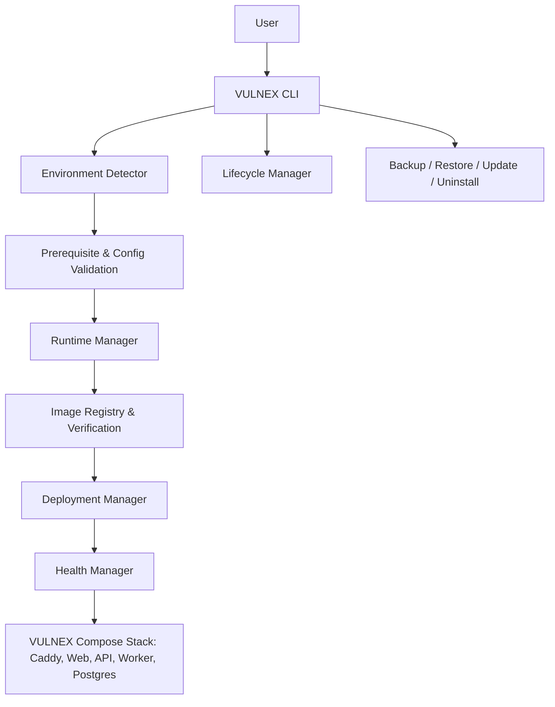

# Installer Architecture

## 1. Overview

VULNEX Installer is a standalone Go CLI control plane distributed as a self-contained binary (`vulnex`). It resides within the unified monorepo (`installer/`) with an independent Go module, building without importing backend business logic, database drivers, or frontend code (ADR-012). It provisions and manages VULNEX application containers via Docker Compose.

## 2. Bounded contexts

| Context | Responsibility |
|---|---|
| Environment | OS, architecture, memory, disk, runtime availability |
| Installation | Install plan, preflight, provisioning workflow |
| Runtime | Docker Engine and Compose capability |
| Configuration | Config loading, validation, secret generation |
| Deployment | Image resolution, compose rendering, deployment |
| Lifecycle | Start, stop, restart, status, logs |
| Maintenance | Backup, restore, upgrade, uninstall |
| Diagnostics | Health checks, diagnostic bundle, actionable errors |

## 3. Clean Architecture

Dependency direction:

`Delivery → Application → Domain ← Infrastructure`

- Delivery: Cobra commands and CLI presenters.
- Application: use cases and orchestration.
- Domain: installation policies, deployment profile, release compatibility, invariants.
- Infrastructure: Docker adapter, filesystem adapter, registry client, OS detector, process runner.

Domain must not import Docker SDK, Cobra, `os/exec`, HTTP clients, or filesystem implementation packages.

## 4. Key use cases

- `DiagnoseEnvironment`
- `PlanInstallation`
- `InstallVulnex`
- `GenerateAdminBootstrapToken` (ephemeral setup token generation, ADR-013)
- `GetInstallationStatus`
- `StartDeployment`
- `StopDeployment`
- `RestartDeployment`
- `CollectLogs`
- `ValidateConfiguration`
- `CreateBackup`
- `RestoreBackup`
- `PlanUpgrade`
- `ApplyUpgrade`
- `UninstallVulnex`

## 5. Ports

- `RuntimePort`: inspect runtime, compose up/down, list services, read logs.
- `ReleaseRegistryPort`: resolve release manifest and retrieve artifacts.
- `ArtifactVerifierPort`: verify checksum and signature.
- `ConfigRepository`: load/save validated configuration.
- `SecretGenerator`: generate cryptographically secure secrets.
- `FilesystemPort`: create directories, permissions, atomic writes.
- `HealthCheckPort`: check readiness and component health.
- `BackupPort`: export and restore persistent data.

## 6. Domain invariants

- Installation has one selected deployment mode.
- A deployment cannot be marked Ready until required health checks pass.
- An upgrade must pass compatibility validation before mutation.
- Existing persistent data must not be removed by install/update.
- Destructive uninstall requires explicit confirmation and data-retention selection.
- Only verified release artifacts can be deployed.
- A repeated install operation must be idempotent.

## 7. Runtime topology

- Ingress plane (Server mode): Embedded Caddy reverse proxy providing automated ACME TLS provisioning for the configured domain (ADR-014). External reverse proxy supported with trusted upstream CIDR configuration.
- Management plane: CLI control plane, API (`cmd/api`), frontend (`Next.js`).
- Data plane: PostgreSQL and optional Redis.
- Scanner plane: isolated worker containers with controlled egress.
- Database and Redis are private to the Compose network.
- Scanner workers must not have Docker socket access.
- The Docker socket must not be mounted into application, web, or scanner containers.
- Initial admin bootstrapping: Installer provisions an ephemeral setup token into PostgreSQL (`setup_tokens`), displayed once in stdout with onboarding instructions.

## 8. Failure handling

Use explicit phases with durable state:
1. Preflight
2. Configuration
3. Artifact verification
4. Storage preparation
5. Deployment
6. Health validation
7. Commit installation state

On failure, report the failed phase and preserve logs. Roll back only reversible deployment changes. Never delete user data automatically.
